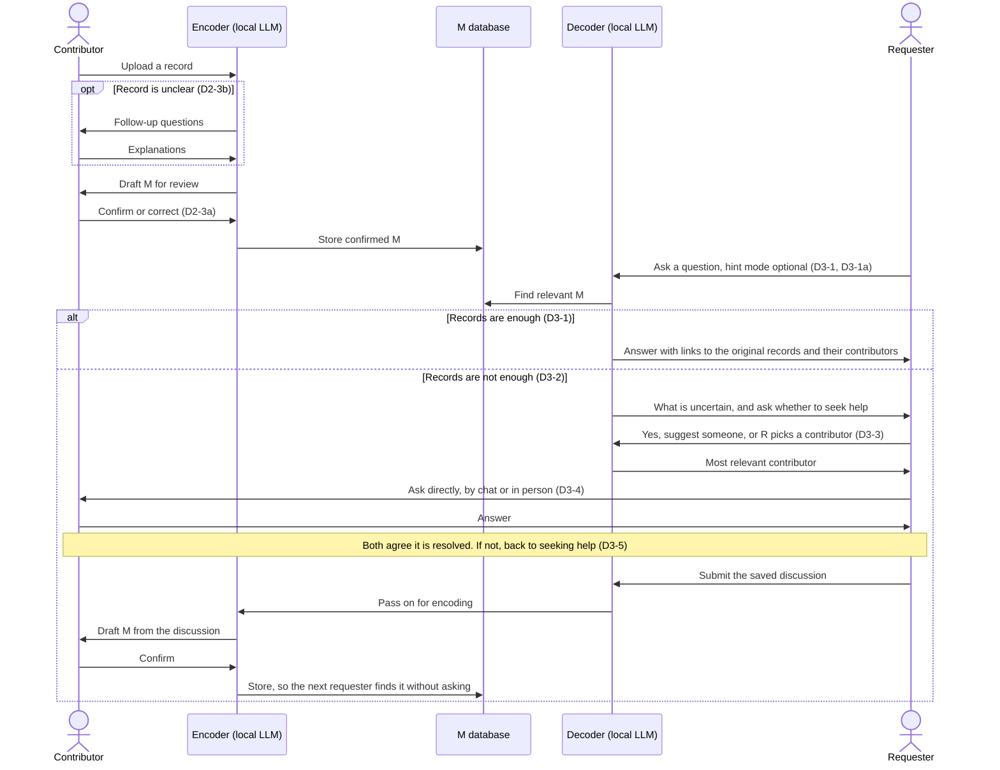

# CP1: Interaction Design Sketch
This system organizes information scattered across the laboratory into searchable knowledge, helping lab members obtain answers and access the original materials. When the available information is insufficient, it seeks assistance from relevant contributors with the requester's consent and preserves discussions that successfully resolve questions as new information for future retrieval.

This is our provisional direction. It centres on the moment one lab member needs a labmate's experimental knowledge. As [02 §5](https://github.com/benedictdavon/nycu-ai-itl/blob/main/docs/cp1/02_problem_statement.md#5-scope-and-open-questions) says, we have not yet decided whether to focus on troubleshooting knowledge, experiment details, or handover between members, and we will narrow it after more feedback from users.

## How Two Lab Members Use It

The two roles are the `contributor`, usually the experienced member who did the experiment, and the `requester`, usually a member who needs to repeat or troubleshoot it. The terms are defined in D2‑1 and D3‑1 below.



| Step | Who | What they do | What passes to the other person |
|---|---|---|---|
| 1 | Contributor | Uploads a record of an experiment (D2‑2c). | — |
| 2 | Encoder | Drafts `M` and asks follow-up questions if the record is unclear (D2‑3a / D2‑3b). | — |
| 3 | Contributor | Confirms or corrects the draft. Only confirmed `M` is stored (D2‑3a). | The confirmed record becomes findable by every requester. |
| 4 | Requester | Asks a question, with or without hint mode (D3‑1 / D3‑1a). | — |
| 5 | Decoder | Answers with links to the original records and names their contributors (D3‑1). If the records are not enough, it says what is uncertain and asks whether the requester wants to seek help (D3‑2). | The requester sees who contributed each record. |
| 6 | Requester | If they want help, picks a contributor themselves or asks the decoder to suggest the most relevant one (D3‑3), then asks that contributor directly (D3‑4). | The question passes to the contributor. |
| 7 | Contributor | Answers the question. | The answer passes back to the requester. |
| 8 | Requester and contributor | Both confirm that the question is resolved. The requester submits the saved discussion to the decoder, the encoder drafts a new `M` from it, and the contributor confirms it (D3‑4, then D2‑3a). If the question is not resolved, the requester goes back to step 6 and may ask someone else (D3‑5). | The answer is stored, so the next requester finds it at step 5 instead of asking again. |

## Inputs and Outputs

| Role | Inputs | Outputs |
|---|---|---|
| Contributor | Files: PDF, DOCX, plain text, and Benchling exports. The contributor's name is required (D1‑4), and a project tag is optional. Also confirmations or corrections of draft `M`, and answers to follow-up questions. | Draft `M` to review, follow-up questions, and questions passed on by requesters who chose them (D3‑3). |
| Requester | A question in plain language, the hint-mode setting, the choice of whether to ask a person and whom, and the resolved discussion to save. | An answer that links the original records and names their contributors, or a statement of what is missing plus a suggested contributor. |
| Stored | — | Confirmed `M` in the `M database`. |

Screenshots and photos of paper notes are allowed by the design (D1‑1, D3‑4). Whether the first version can read them depends on the local model, so a pasted text summary is the fallback.

**Example** (illustrative, with made-up values; not real lab data)

`info`, the contributor's Benchling note:

> Transformation of strain X with plasmid P, following Drive SOP "Transformation v2". First try: few colonies, cells clumped after washing. Second try: doubled the wash volume, used 50 ng plasmid. Normal colonies.

The encoder asks one follow-up question (D2‑3b): "Did you change the recovery step?" The contributor answers: "No, same as the SOP." The encoder then drafts this `M`, and the contributor confirms it (D2‑3a):

```text
Procedure:       Transformation of strain X with plasmid P
Based on:        Drive SOP "Transformation v2" (link)
Contributor:     Member S
Project tag:     Project X
Changes from SOP:
  - Wash volume doubled. Reason: cells clumped with the SOP volume.
  - Plasmid amount: 50 ng.
  - Recovery step: unchanged (answered by S in a follow-up question).
Troubleshooting: First attempt gave few colonies. Fixed by the wash change above.
Source:          Benchling entry "Transformation strain X" (link)
Confirmed by:    Member S
```

A requester, Member N, asks: "Has anyone transformed strain X? What did they change from the SOP?" The decoder answers that Member S did, lists the two changes and the reason for the wash change, and links the Benchling entry (D3‑1). If N then asks "Why did the cells clump?", nothing in the records explains it. The decoder says so, names S as the only contributor with records on strain X, and asks whether N wants to ask S (D3‑2 / D3‑3).

## D1. Information Representation
| ID | Design Specification |
|---|---|
| D1‑1 | `info` refers to any laboratory-related information, whether accessible over a network or offline. Sources include, but are not limited to, Benchling, Google Drive, NAS, and handwritten paper records. Information types include, but are not limited to, programs, documents, images. |
| D1‑2 | `M` is a precise plain-text description of `info`. Each `info` item corresponds to exactly one `M`. |
| D1‑3 | `M` can be rendered as understandable Markdown. Where appropriate, the Markdown includes links to the original `info` associated with `M`. |
| D1‑4 | `M` must include at least one `contributor`. Research project groups and other attributes may be added as appropriate using tags or groups. |

## D2. Input — Encoder System
The `encoder` is a local language model that interprets and organizes unstructured records to produce `M`. See [02 §5](https://github.com/benedictdavon/nycu-ai-itl/blob/main/docs/cp1/02_problem_statement.md#5-scope-and-open-questions).
The surrounding system handles acquiring `info` and triggering updates, aiming to improve information coverage, synchronization, and accuracy.

| ID | Design Specification |
|---|---|
| D2‑1 | A `contributor` is a lab member who has contributed to an `info` item. Contributors may include professors. |
| D2‑2a | For information accessible over a network, when the time since the corresponding `M` was last updated exceeds a configured interval, the `encoder` accesses the `info` through tools. |
| D2‑2b | For offline information, when the time since the corresponding `M` was last updated exceeds a configured interval, the `encoder` asks a `contributor` whether the associated `info` has changed. If it has, the contributor is asked to upload the updated information. |
| D2‑2c | An `info` item that the `encoder` has never encountered must be proactively submitted by a `contributor`; the encoder cannot discover information that has not been made available to it. |
| D2‑3a | If the `encoder` considers the `info` sufficiently clear, it converts the information into `M` and notifies a `contributor` for review. The contributor may discuss and revise the content with the encoder. Only after the contributor confirms it is `M` added to the `M database`. |
| D2‑3b | If the `encoder` considers the `info` unclear, it asks a `contributor` for additional explanations until the conditions in D2‑3a are met. |

## D3. Output — Decoder System
The `decoder` is a local language model that interprets the requester's natural-language questions, finds relevant information, and organizes it into an answer. See [02 §5](https://github.com/benedictdavon/nycu-ai-itl/blob/main/docs/cp1/02_problem_statement.md#5-scope-and-open-questions).

| ID | Design Specification |
|---|---|
| D3‑1 | A `requester` submits a question through a text-based question-and-answer interface. If the `decoder` considers the `M database` sufficiently clear to answer the question, it provides an answer together with the original `info` linked to the relevant `M`, and names the `contributor`s of that `M`. |
| D3‑1a | A `requester` who wants to learn how to troubleshoot may enable a setting that makes the `decoder` provide hints instead of a detailed answer. |
| D3‑2 | If the `decoder` considers the available information insufficient to answer clearly, it explains its uncertainties and tentative inferences, then asks whether the `requester` wants to seek help from another person. |
| D3‑3 | If the `requester` wants to seek help, they may select a `contributor` themselves or ask the `decoder` to find a contributor with the most relevant expertise in the `M database`. If no sufficiently relevant contributor is found, the decoder notifies the requester. |
| D3‑4 | The `requester` discusses the question with the selected `contributor` using any communication method. If both confirm that the question has been resolved, the requester saves the discussion as `info`, such as conversation screenshots and other files, and sends it to the `decoder` to indicate resolution. This information is then processed according to D2‑3a / D2‑3b. |
| D3‑5 | If the discussion in D3‑4 does not resolve the question, the `decoder` follows D3‑2 and asks whether the `requester` wants to seek help from another person. |

## First Version (Planned for CP2)

This scope was discussed in PR #8. It is provisional and depends on a local model running well enough on our hardware (see 04 §5).

| In the first version | After CP2 |
|---|---|
| Contributors upload or paste files themselves: PDF, DOCX, plain text and Benchling exports (D2‑2c). This also covers records on personal computers and GoodNotes exports. | Automatic access to Benchling, Google Drive and the NAS (D2‑2a). We have not yet checked whether the lab's accounts allow it. |
| The encoder drafts `M` with a required contributor (D1‑4) and asks **at most two follow-up questions** per record (D2‑3b). The contributor confirms or corrects the draft on one review screen (D2‑3a). If the record is still unclear after two questions, the contributor fills the gaps while reviewing. | Reminders to update offline records (D2‑2b). |
| Answers link their source records and name their contributors (D3‑1), with optional hint mode (D3‑1a). | Reading screenshots, photos and handwritten notes, if the local model can handle them. |
| When the records are not enough, the requester is pointed to one contributor, and the resolved discussion is saved as pasted text (D3‑2 to D3‑5). | Access permissions for different lab members (see 5b‑4). |
| Professors can upload like any other contributor, but there is no separate professor role. | A separate professor workflow (see F3‑1 and F3‑4). |

## Design Questions That May Remain Open at CP1
- How contributors are notified under D2-3a / D2-3b.
- The criteria used by the decoder to judge whether it can answer accurately under D3-1 / D3-2.
- Whether a local model on our hardware is accurate enough for the first version (see 04 §5).
- Access permissions for different lab members.

## Design Coverage of Requirements and Interview Findings

The original 15 items and their IDs are retained for comparison with the earlier problem statement. Four supplementary findings from [02 §3](https://github.com/benedictdavon/nycu-ai-itl/blob/main/docs/cp1/02_problem_statement.md#3-what-researchers-told-us) are added below as F3‑1 through F3‑4; these are local traceability labels for this table, not IDs assigned in 02.

Ratings assess the mechanisms specified in the current D1–D3 design, not implementation completion or measured user outcomes. Green indicates an explicit mechanism addressing the item; yellow indicates partial coverage or a remaining dependency; red indicates that no mechanism is specified or that the requirement remains unresolved. Interview statements are attributed to their participants or the combined notes rather than assumed to apply to every researcher.

| ID | Item | Design Coverage | Reason |
|---|---|---|---|
| 4‑1 | Benchling limitations | 🟡&nbsp;Partially&nbsp;Addressed | D2‑2a accesses existing records, and D2‑3a / D2‑3b provide contributor review and clarification. These mechanisms help with recorded but unclear details. D2‑2c still depends on contributors submitting new information, so unrecorded protocol changes may remain absent. |
| 4‑2 | Google Drive limitations | 🟢&nbsp;Addressed&nbsp;in&nbsp;Design | D2‑2a and D3‑1 provide question-based retrieval of available records and return the original materials. This directly addresses locating existing protocols without knowing their file location, as described by Participant A; it does not recover changes that were never supplied. |
| 4‑3 | Ask Gemini in Drive limitations | 🟢&nbsp;Addressed&nbsp;in&nbsp;Design | The local encoder and decoder provide retrieval and answers without requiring Gemini availability on the lab's account. D2‑2a / D2‑2c cover accessible and submitted information from the sources in D1‑1. Unsubmitted information remains unavailable. |
| 4‑4 | NAS, personal computers, and GoodNotes limitations | 🟡&nbsp;Partially&nbsp;Addressed | D1‑1 includes network-accessible and offline information, and D2‑2b / D2‑2c allow uploads. This provides a submission route for records on personal devices, but it does not specify direct GoodNotes integration or synchronization between devices. |
| 4‑5 | Directly asking researchers | 🟡&nbsp;Partially&nbsp;Addressed | D3‑3 helps identify a contributor, D3‑4 preserves resolved discussions, and D3‑5 asks for consent before seeking further help. This supports finding help and reusing answers, but coverage still depends on recorded contributor information, their availability, and submission of the discussion. |
| 5a‑1 | Repeated questions to senior researchers | 🟡&nbsp;Partially&nbsp;Addressed | D3‑1 supports retrieval before asking someone, and D3‑4 returns resolved discussions to the knowledge base. Reuse is therefore supported for submitted, reviewed answers, while unsubmitted or unresolved exchanges remain unavailable. This addresses the repeated interruptions reported by A only in part. |
| 5a‑2 | Difficulty locating existing records | 🟢&nbsp;Addressed&nbsp;in&nbsp;Design | D2‑2a / D2‑2b / D2‑2c make accessible or submitted records available through the system, and D3‑1 returns answers with original materials. The design supports locating covered records without remembering their device or folder. B's reported search concerned B's own records; difficulty for another labmate was an inference in 02, not an observed event. |
| 5a‑3 | Incomplete experimental documentation | 🟡&nbsp;Partially&nbsp;Addressed | D2‑3a / D2‑3b allow contributors to correct extracted content and explain unclear records. These steps can improve submitted documentation, but D2‑2c cannot discover important details that nobody records or supplies. This limitation applies to the routine changes reported by A and the brief records described in the combined notes. |
| 5a‑4 | Unrecorded troubleshooting knowledge | 🟡&nbsp;Partially&nbsp;Addressed | A and B reported that troubleshooting solutions were not written down. D3‑4 captures newly resolved discussions and processes them through D2‑3a / D2‑3b. The design does not automatically collect existing experience that remains only in people's heads. |
| 5a‑5 | Junior researchers' dependence on senior researchers | 🟡&nbsp;Partially&nbsp;Addressed | D3‑1 supports retrieval and D3‑1a provides hints for learning, while D3‑3 / D3‑4 retain access to experienced contributors. The combined notes describe hands-on skills and judgment that are difficult to teach in writing, so human instruction remains necessary. |
| 5b‑1 | Reuse existing files | 🟢&nbsp;Addressed&nbsp;in&nbsp;Design | D1‑1 accepts existing records, D2‑2a accesses network information through tools, and D2‑2b / D2‑2c accept uploads. The design can build on existing sources without requiring all original files to be moved or reorganized. |
| 5b‑2 | Low documentation overhead | 🟡&nbsp;Partially&nbsp;Addressed | D1‑1 accepts existing information formats, and D3‑4 allows discussion screenshots and other files to be submitted. This reduces the need to rewrite material into a fixed form, but review, clarification, update requests, and discussion submission still require contributor or requester effort. |
| 5b‑3 | Show experiment owners | 🟡&nbsp;Partially&nbsp;Addressed | D1‑4 requires at least one contributor, D3‑1 names the contributors with each answer, and D3‑3 helps identify a relevant person. However, D2‑1 defines contribution to information, which does not necessarily identify who performed the experiment. That distinction is not explicitly shown to the requester. |
| 5b‑4 | Keep unpublished data private | 🔴&nbsp;Pending&nbsp;Discussion | The encoder and decoder use local language models, which addresses the inference location. Access permissions, data isolation, and the complete data-transfer policy remain unspecified, so the design does not yet fully address A's requirement for unpublished data to stay inside the lab. |
| 5b‑5 | Support independent troubleshooting | 🟢&nbsp;Addressed&nbsp;in&nbsp;Design | D3‑1a explicitly lets requesters choose hints instead of detailed answers. D3‑1 and D3‑2 / D3‑3 also provide retrieval and optional human assistance. This creates a mechanism for the learning preference described in the combined notes; its learning benefit has not been evaluated. |
| F3‑1 | Professor helps identify who has done an experiment (Participant A) | 🟡&nbsp;Partially&nbsp;Addressed | D2‑1 allows professors to contribute, D1‑4 records contributors, and D3‑3 finds relevant people. However, the professor's knowledge of who performed which experiment must first be submitted and confirmed; the design does not automatically acquire that knowledge or define a separate professor workflow. |
| F3‑2 | Mobile note-taking and cross-platform synchronization difficulties (combined notes) | 🔴&nbsp;Not&nbsp;Addressed | The combined notes describe Benchling being difficult to use on a phone and Apple Notes not synchronizing with the lab's Windows computers. D1‑1 accepts existing materials, but no mobile note-taking interface or cross-platform synchronization mechanism is specified. General upload support does not by itself resolve these reported difficulties. |
| F3‑3 | Small protocol changes are forgotten (combined notes) | 🟡&nbsp;Partially&nbsp;Addressed | The combined notes describe meaningful small changes being remembered for about a month and inconsequential changes being forgotten. D2‑2b can prompt contributors to update known offline information, but D2‑2c still relies on proactive submission of new information. The design does not ensure that unrecorded changes are captured before they are forgotten. |
| F3‑4 | Professor's verbal instructions are often not recorded (combined notes) | 🟡&nbsp;Partially&nbsp;Addressed | D2‑1 allows professors to contribute, and D2‑2c / D2‑3a / D2‑3b support manual submission and review. D3‑4 can preserve instructions included in a resolved discussion. Instructions given outside this workflow still require someone to record and submit them; there is no general capture mechanism for spoken instructions. |

Summary of design coverage (19 items): 🟢 5 Addressed in Design, 🟡 12 Partially Addressed, 🔴 2 Not Addressed / Pending Discussion
